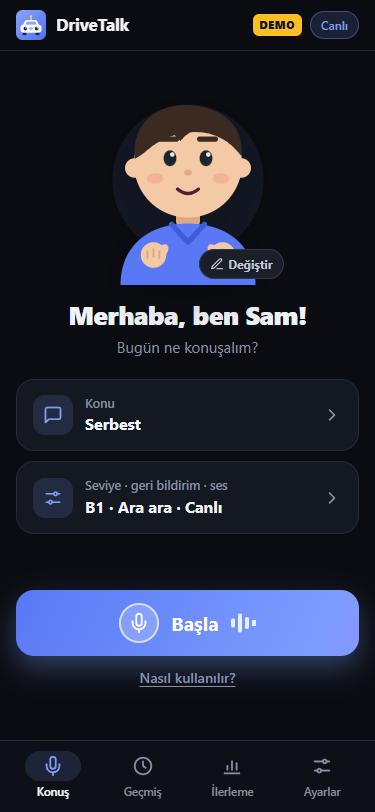
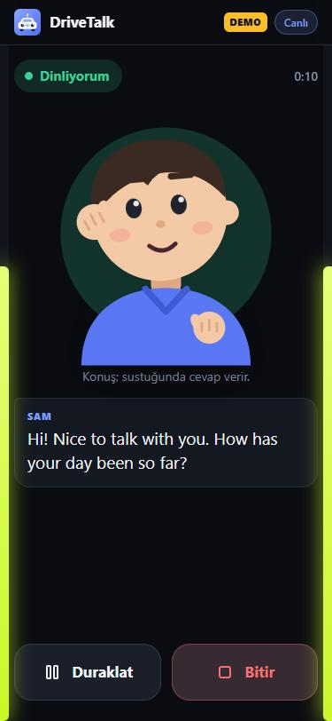
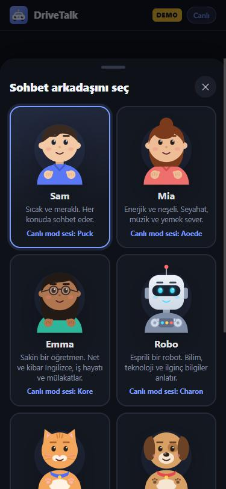
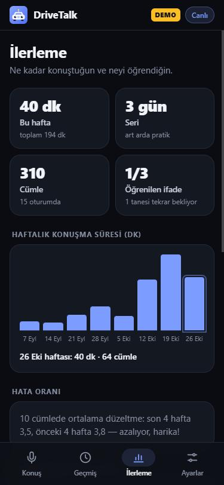

<p align="center">
  
</p>

<h1 align="center">DriveTalk</h1>

<p align="center">
  <b>Hands-free English speaking practice for your drive.</b><br>
  An AI conversation partner that listens, talks back and coaches you. Free to use.
</p>

<p align="center">
  <a href="https://kaansoyaslan.github.io/drivetalk/"><b>▶ Open the app</b></a>
  &nbsp;·&nbsp;
  <a href="#türkçe">🇹🇷 Türkçe</a>
</p>

<p align="center">
  
  
  
  
</p>

## Overview

DriveTalk is a progressive web app (PWA) for practising spoken English while you drive. You tap **Start** once while parked, and from then on everything works by voice. Your conversation partner replies naturally and quietly notes your mistakes. It gives you short spoken feedback during the session, and a written summary is ready when you stop.

It runs entirely in the phone's browser. There is no server, no account and no cost. Conversations use the free tier of the Google Gemini API with your own key.

## Features

**Conversation**
- **Live mode:** real-time voice conversation with Gemini Live. Natural voices, instant replies, and you can interrupt at any time.
- **Classic mode:** uses the phone's own speech recognition and voice. The app switches to it automatically if Live mode can't connect.
- **Eight characters:** Sam, Mia, Emma, Robo, Tiko the cat, Max the dog, Ollie the owl and Zip the alien, each with their own look, personality and voice. They react as you talk: a hand to the ear while listening, a hand on the chin while thinking, and moving mouth, hands and eyebrows while speaking.
- **Topics and role-plays:**
  - Conversation: free talk, today's news, fun facts, daily life, work and travel.
  - Role-plays: a job interview, the airport, a hotel, a restaurant, the doctor, customer service and a shop.
  - Practice: listening practice and vocabulary review.

**Coaching**
- Every sentence is reviewed in the background: what you said, a better version and why, explained in English and Turkish.
- Feedback while you talk (instantly or every few sentences) or only at the end, followed by a spoken summary.
- **Vocabulary notebook** with spaced repetition. Useful phrases are collected automatically and reviewed with "quiz me".
- **Progress:** weekly speaking time, streak, error rate and error types.

**Live information (free, no API keys)**
- Weather (Open-Meteo), recent news and facts (Wikipedia), exchange rates (European Central Bank via Frankfurter). The character decides when to look something up.

**Built for the car**
- Fully voice-controlled. The reply comes automatically when you stop talking.
- A glowing bar along each edge of the screen rises with the sound and changes colour with its loudness (your voice: cyan → green → yellow → red; the character: blue → purple → pink), so you can see at a glance that your voice is coming through.
- **Microphone choice (Live mode):** use the phone's own microphone instead of the car's Bluetooth one (or any other), test it with a level meter and a chime, and the choice is saved.
- Steering-wheel and headset media buttons: play/pause, next topic, repeat.
- Keeps the screen awake and reconnects automatically after a lost connection.

## Getting started

1. Get a **free Gemini API key** at <https://aistudio.google.com/apikey>.
2. Open <https://kaansoyaslan.github.io/drivetalk/> in **Chrome** on your phone, then use ⋮ → **Add to Home screen** (or **Install app**).
3. In **Settings**, paste your API key. Optionally, enter your city for weather questions.
4. On **Talk**, pick a character and a topic, tap **Start** and allow the microphone.

> On the free tier, Google may use the content sent to Gemini to improve its products.

## Voice commands

| Say | What happens |
|---|---|
| "feedback", "how am I doing?" | Reads out your recent mistakes |
| "quiz me" | Vocabulary quiz from your notebook |
| "repeat", "say that again" | Repeats the last sentence |
| "slower" / "faster" | Changes the speaking speed |
| "new topic" | Moves on to a new topic |
| "hold on", "pause" | Waits until you continue |
| "that's all for today" | Gives a spoken summary and ends the session |

## Privacy

- Your API key, history, vocabulary and progress are stored only in your phone's browser (localStorage). Nothing is stored on GitHub or on any other server.
- Conversations are processed by Google Gemini. In Classic mode, speech recognition runs through Chrome, which uses Google's servers.
- Look-ups send only the search words to Wikipedia, Open-Meteo or Frankfurter. If you turn on location, only the coordinates are sent, and only to Open-Meteo.

## Run locally

With Windows PowerShell (any static file server works too):

```powershell
powershell -ExecutionPolicy Bypass -File serve.ps1
```

Then open <http://localhost:8080>.
- To try it without an API key, open <http://localhost:8080/?demo>. It uses canned replies, including a simulated Live mode.
- To test without a microphone, go to *Settings → Gelişmiş (Advanced) → Yazarak test modu (type-to-test mode)*.

## Project structure

| File | Purpose |
|---|---|
| `js/app.js` | Session flow (Classic and Live), screens, progress, settings |
| `js/live.js` | Gemini Live client: audio streaming, playback, end-of-speech fallback, reconnection |
| `js/devices.js` | Microphone and speaker choice, audio test |
| `js/juice.js` | Touch feedback: ripples, haptics, sheet and list animations |
| `js/pcm-worklet.js` | Converts microphone audio to 16 kHz PCM |
| `js/tutor.js` | Prompts for the partner, coach, quiz and summary; topics |
| `js/characters.js` | Characters: look, personality, voice and animation rig |
| `js/lookup.js` | Free live data: weather, news, Wikipedia, exchange rates |
| `js/speech.js` | Classic mode: speech recognition and speech synthesis |
| `js/gemini.js` | Gemini API client and demo mode |
| `js/live-mock.js` | Simulated Live server for demo mode |
| `js/media-keys.js` | Steering-wheel and headset media buttons |
| `js/store.js` | Settings, history and vocabulary notebook (on device) |
| `sw.js`, `manifest.webmanifest` | Installable, offline-capable PWA |

It is built with plain HTML, CSS and JavaScript, with no framework and no build step. It uses the Web Speech API, Web Audio (AudioWorklet) and the Gemini Interactions and Live APIs.

## Known limitations

- The screen must stay on. Chrome stops listening when the phone is locked.
- An internet connection is required.
- The free Gemini tier has per-minute and daily limits; you can check them in AI Studio.
- Whether the steering-wheel buttons work depends on the car and the phone.
- On Android, the system decides where Live mode audio goes. With echo cancellation on, it is treated like a phone call (with a Bluetooth car kit, usually the car's microphone and call-quality sound). With it off, the sound plays like music and the selected phone microphone is used, but you can't interrupt the character while it speaks.

---

## Türkçe

<p>
  <b>Araba sürerken eller serbest İngilizce konuşma pratiği.</b><br>
  Seni dinleyen, cevap veren ve hatalarını düzelten bir yapay zekâ sohbet arkadaşı. Kullanımı ücretsiz.
</p>

**Uygulamayı aç:** <https://kaansoyaslan.github.io/drivetalk/>

### Genel bakış

DriveTalk, araba sürerken İngilizce konuşma pratiği yapmak için telefonun tarayıcısında çalışan bir web uygulamasıdır (PWA). Park halindeyken bir kez **Başla**'ya basarsın, sonrası tamamen sesle yürür. Sohbet arkadaşın doğal şekilde cevap verir ve hatalarını sessizce not eder. Sohbet sırasında kısa sesli geri bildirimler verir; bitirdiğinde yazılı bir özet hazır olur.

Sunucu, hesap ya da ücret yok. Sohbetler, kendi anahtarınla Google Gemini API'nin ücretsiz katmanını kullanır.

### Özellikler

**Sohbet**
- **Canlı mod:** Gemini Live ile gerçek zamanlı sesli sohbet. Doğal ses, anında cevap; istediğin an sözünü kesebilirsin.
- **Klasik mod:** Telefonun kendi konuşma tanıması ve sesi. Canlı mod bağlanamazsa uygulama otomatik olarak buna geçer.
- **Sekiz karakter:** Sam, Mia, Emma, Robo, kedi Tiko, köpek Max, baykuş Ollie ve uzaylı Zip. Her birinin görünüşü, kişiliği ve sesi farklı. Dinlerken elini kulağına götürür, düşünürken elini çenesine koyar, konuşurken ağzı, elleri ve kaşları oynar.
- **Konular ve rol yapma:**
  - Sohbet: serbest sohbet, günün haberleri, ilginç bilgiler, günlük hayat, iş ve seyahat.
  - Rol yapma: iş mülakatı, havalimanı, otel, restoran, doktor, müşteri hizmetleri ve mağaza.
  - Pratik: dinleme pratiği ve kelime tekrarı.

**Koçluk**
- Her cümlen arka planda incelenir: ne dedin, daha iyisi ne ve neden. Açıklamalar İngilizce ve Türkçedir.
- Sohbet sırasında (anında ya da birkaç cümlede bir) veya sadece sonda geri bildirim, ardından sesli özet.
- **Kelime defteri:** Faydalı ifadeler otomatik toplanır, "quiz me" ile aralıklı tekrar yapılır.
- **İlerleme:** haftalık konuşma süresi, art arda pratik yapılan gün sayısı, hata oranı ve hata türleri.

**Canlı bilgi (ücretsiz, anahtarsız)**
- Hava durumu (Open-Meteo), güncel haberler ve bilgiler (Wikipedia), döviz kurları (Frankfurter üzerinden Avrupa Merkez Bankası). Ne zaman bakacağına karakter karar verir.

**Araba için tasarlandı**
- Tamamen sesle kontrol edilir. Sustuğunda cevap kendiliğinden gelir.
- Ekranın iki kenarındaki parlayan çubuk sesle yükselir ve sesin şiddetine göre renk değiştirir (senin sesin: camgöbeği → yeşil → sarı → kırmızı; karakterin: mavi → mor → pembe). Sesinin gittiğini göz ucuyla görürsün.
- **Mikrofon seçimi (Canlı mod):** Arabanın Bluetooth mikrofonu yerine telefonun kendi mikrofonunu (ya da başka birini) seç, seviye göstergesi ve zil sesiyle dene; seçimin saklanır.
- Direksiyon ve kulaklık tuşları: duraklat/devam, yeni konu, tekrar.
- Ekranı açık tutar, bağlantı koparsa kendiliğinden yeniden bağlanır.

### Başlarken

1. <https://aistudio.google.com/apikey> adresinden **ücretsiz Gemini API anahtarı** al.
2. Telefonda **Chrome** ile <https://kaansoyaslan.github.io/drivetalk/> adresini aç, ⋮ → **Ana ekrana ekle** (ya da **Uygulamayı yükle**) de.
3. **Ayarlar**'da API anahtarını yapıştır. İstersen hava durumu soruları için şehrini yaz.
4. **Konuş** ekranında karakter ve konu seç, **Başla**'ya bas ve mikrofon iznini ver.

> Ücretsiz katmanda Google, Gemini'ye gönderilen içeriği ürünlerini geliştirmek için kullanabilir.

### Sesli komutlar

| Söyle | Ne olur |
|---|---|
| "feedback", "how am I doing?" | Son hatalarını okur |
| "quiz me" | Kelime defterinden test yapar |
| "repeat", "say that again" | Son cümleyi tekrarlar |
| "slower" / "faster" | Konuşma hızını değiştirir |
| "new topic" | Yeni bir konuya geçer |
| "hold on", "pause" | Sen devam edene kadar bekler |
| "that's all for today" | Sesli özet verir ve oturumu bitirir |

### Gizlilik

- API anahtarın, geçmişin, kelime defterin ve ilerlemen sadece telefonunun tarayıcısında (localStorage) saklanır. GitHub'a ya da başka bir sunucuya hiçbir şey kaydedilmez.
- Sohbetler Google Gemini tarafından işlenir. Klasik modda konuşma tanıma, Google'ın sunucularını kullanan Chrome üzerinden yapılır.
- Aramalarda Wikipedia, Open-Meteo ya da Frankfurter'a sadece aranan kelimeler gider. Konumu açarsan sadece koordinatlar, sadece Open-Meteo'ya gönderilir.

### Bilgisayarda çalıştırma

Windows PowerShell ile (herhangi bir statik dosya sunucusu da olur):

```powershell
powershell -ExecutionPolicy Bypass -File serve.ps1
```

Ardından <http://localhost:8080> adresini aç.
- API anahtarı olmadan denemek için <http://localhost:8080/?demo> adresini kullan. Hazır cevaplarla çalışır, Canlı mod da taklit edilir.
- Mikrofonsuz test için *Ayarlar → Gelişmiş → Yazarak test modu*.

### Bilinen sınırlamalar

- Ekran açık kalmalı. Telefon kilitlenirse Chrome dinlemeyi durdurur.
- İnternet bağlantısı gerekir.
- Gemini'nin ücretsiz katmanında dakikalık ve günlük sınırlar var; AI Studio'dan görebilirsin.
- Direksiyon tuşlarının çalışması arabaya ve telefona göre değişir.
- Android'de Canlı mod sesinin nereden çıkacağına sistem karar verir. Yankı engelleme açıkken telefon görüşmesi gibi davranır (Bluetooth araç kitinde genelde arabanın mikrofonu ve görüşme kalitesinde ses). Kapalıyken ses müzik gibi çalar ve seçtiğin telefon mikrofonu kullanılır, ama karakter konuşurken sözünü kesemezsin.
